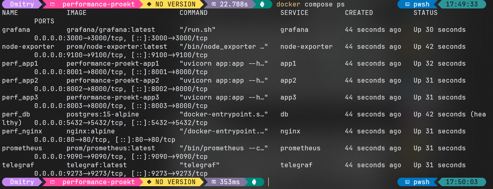
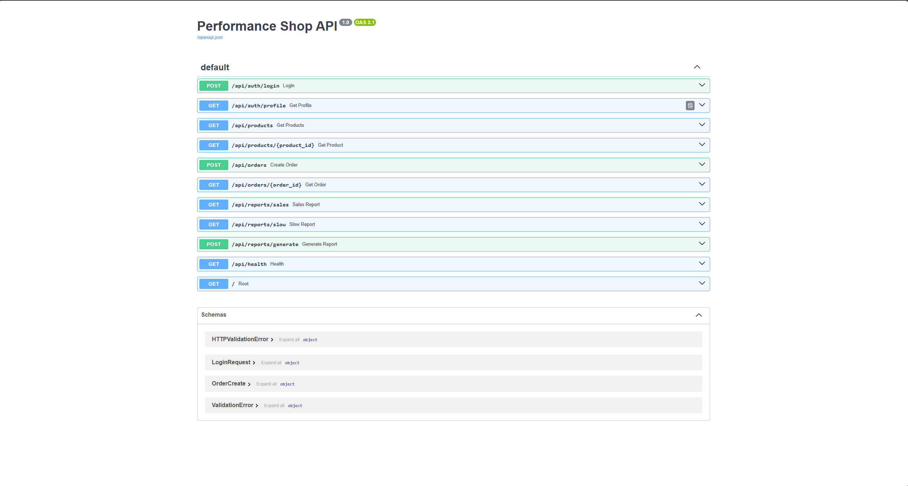
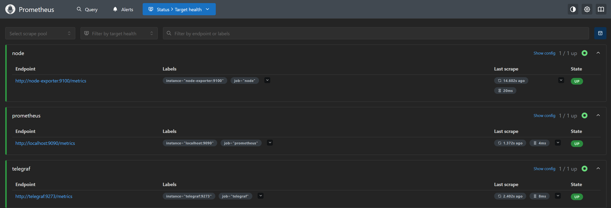
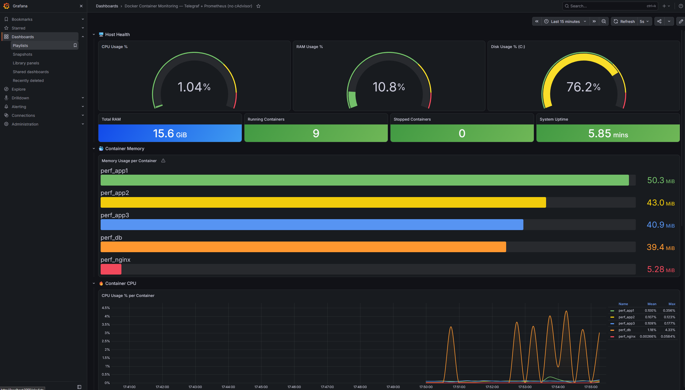
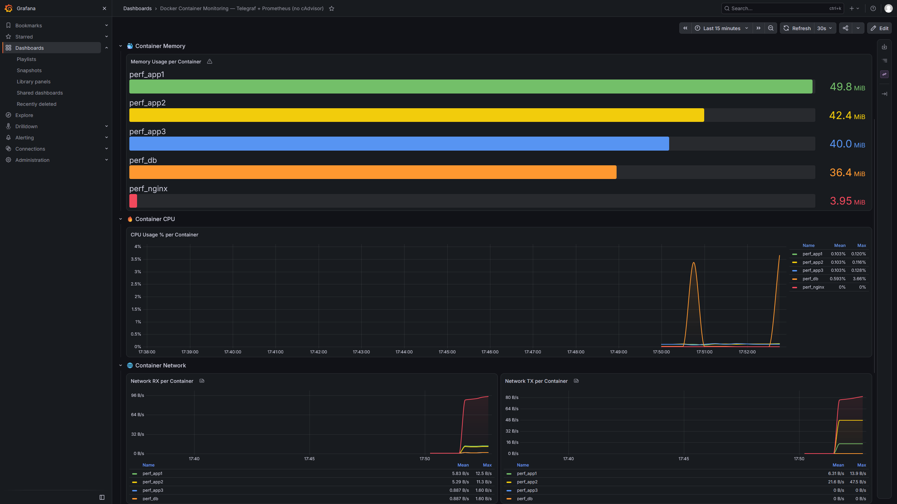

# Performance Shop: развёртывание и мониторинг

Тестовое приложение интернет-магазина (FastAPI + PostgreSQL + nginx, 3 инстанса) в Docker
и мониторинг на **Telegraf → Prometheus → Grafana** (+ node-exporter).

## Окружение

| Компонент | Версия |
|---|---|
| ОС | Windows 11 |
| WSL | WSL 2 |
| Docker | 29.9.2 (Docker Desktop) |

## Приложение

| Компонент | Описание |
|---|---|
| Приложение | FastAPI (Python 3.11) |
| БД | PostgreSQL 15 |
| Балансировщик | nginx |
| Инстансы | 3 (порты 8001, 8002, 8003) |

| Метод | Эндпоинт | Описание |
|---|---|---|
| POST | `/api/auth/login` | Авторизация (получаем токен) |
| GET | `/api/auth/profile` | Профиль (требует токен) |
| GET | `/api/products` | Список всех товаров |
| GET | `/api/products/{id}` | Товар по ID |
| POST | `/api/orders` | Создание заказа |
| GET | `/api/orders/{id}` | Заказ по ID |
| GET | `/api/reports/sales` | Отчёт по продажам |
| GET | `/api/reports/slow` | Медленный ответ (параметр `delay`) |
| POST | `/api/reports/generate` | Генерация тяжёлого отчёта |
| GET | `/api/health` | Проверка здоровья сервиса |

Дополнительно приложение отдаёт `GET /` (Root). Тестовые пользователи: `admin`, `user1`, `user2` (пароль у всех `admin123`).

## Запуск

```bash
git clone https://github.com/aberhofff-cmyk/perfomance-monitoring.git
cd perfomance-monitoring
docker compose up -d --build
docker compose ps
curl http://localhost/api/health
```

В ответе `/api/health` приходит JSON с именем инстанса (`app1`, `app2` или `app3`).

Результат `docker compose ps`: все 9 контейнеров запущены (`perf_db` в состоянии healthy):



Swagger UI (http://localhost/docs) с методами API:



## Мониторинг

| Компонент | Что делает | Адрес |
|---|---|---|
| Telegraf | собирает метрики контейнеров (CPU, память, сеть) через `docker.sock` | http://localhost:9273/metrics |
| node-exporter | метрики хоста (CPU, RAM, диск, uptime) | http://localhost:9100 |
| Prometheus | собирает метрики каждые 15 секунд | http://localhost:9090 |
| Grafana | дашборд подключается автоматически | http://localhost:3000 (admin / admin) |

Конфигурация: `telegraf.conf`, `prometheus.yml`, `grafana/`, сервисы в `docker-compose.yml`.

**Дашборд.** Используется дашборд из задания ([Grafana Dashboard 25012](https://grafana.com/grafana/dashboards/25012)).
Оригинал сохранён без изменений в `docs/original/`. В `grafana/dashboards/` лежит адаптированная копия с тем же именем,
в ней две правки: `${DS_PROMETHEUS}` заменено на фиксированный uid источника данных (иначе при автоподключении панели пустые),
запрос панели диска изменён на `mountpoint="/mnt/host/c"` (диск C: в Docker Desktop).

В Prometheus (Status → Target health) все три цели (`node`, `prometheus`, `telegraf`) в состоянии UP:



Дашборд «Docker Container Monitoring» в Grafana. Хост: CPU 1.04 %, RAM 10.8 % из 15.6 GiB, диск C: 76.2 %,
запущено 9 контейнеров, остановленных нет:



## Проверка под нагрузкой

### Простая нагрузка

В PowerShell выполнена серия из 50 последовательных запросов к эндпоинту отчёта по продажам:

```powershell
1..50 | ForEach-Object { curl.exe -s localhost/api/reports/sales | Out-Null }
```

Запросы идут через nginx и распределяются между тремя инстансами. Каждый запрос обрабатывается около 2.5 секунд,
поэтому серия занимает порядка двух минут.



**Наблюдения** (по скриншотам дашборда):

- у `perf_db` видны всплески CPU, максимум за период 4.33 % (среднее 1.18 %);
- у `perf_app1–3` CPU почти не меняется: в среднем около 0.1 %, максимум 0.36 %. Это объясняется тем, что пауза `time.sleep`
  в обработчике отчёта не потребляет процессор;
- память контейнеров стабильна: приложения 40–50 MiB, БД 36–39 MiB, nginx 4–5 MiB, заметного роста нет.

### Параллельная нагрузка (утилита hey)

Для проверки пропускной способности запущено 20 параллельных клиентов на 60 секунд
(утилита [hey](https://github.com/rakyll/hey) во временном контейнере в сети проекта):

```powershell
docker run --rm --network performance-proekt_default williamyeh/hey -z 60s -c 20 http://nginx/api/reports/sales
```

> Имя сети состоит из имени папки проекта и `_default`, проверить его можно командой `docker network ls`.

| Показатель | Значение |
|---|---|
| Успешных ответов (200) | 45 |
| Запросов с таймаутом (20 с) | 24 |
| Запросов в секунду | 1.2 |
| Время ответа: минимум / среднее / максимум | 2.55 / 9.1 / 17.6 с |

Пропускная способность упирается в код эндпоинта: `time.sleep` (1.5 + 1.0 с) внутри `async def`
блокирует event loop, и каждый инстанс обрабатывает один запрос за раз. Три инстанса дают
около 3 / 2.5 ≈ 1.2 запроса в секунду, остальные запросы стоят в очереди, часть не успевает
дождаться ответа за 20 секунд (таймаут клиента `hey`).

## Проблемы и решения

| Проблема | Решение |
|---|---|
| `telegraf.conf` лежал в папке `Доп/`, compose его не находил | перенесён в корень проекта |
| Панели Grafana пустые: дашборд ссылался на `${DS_PROMETHEUS}` | заменено на фиксированный uid источника данных |
| node-exporter: `path / is mounted on / but it is not a shared or slave mount` | в `docker-compose.yml` убран `rslave` |
| Telegraf падал: `configuration specified the fields ["perdevice" "total"]` | в Telegraf 1.38+ опции удалены, заменены на `perdevice_include` и `total_include` |
| Telegraf: `permission denied` на `docker.sock` | добавлены `user: root` и `entrypoint: ["telegraf"]` |
| Панель Disk Usage без данных | в Docker Desktop нет точки монтирования `/`, запрос изменён на `/mnt/host/c` (диск C:) |
| Параллельная команда с `ForEach-Object -Parallel` не запустилась | нагрузка дана обычным циклом и утилитой `hey` в Docker |

## Ограничения

- Docker Desktop работает в виртуальной машине WSL 2, поэтому node-exporter показывает CPU и RAM этой ВМ, а не Windows напрямую.
- Панель диска использует `/mnt/host/c`, который есть в Docker Desktop с WSL 2. В другой среде запрос нужно поправить.
- Метрики самого приложения (RPS, время ответа, ошибки) не собираются, только ресурсы контейнеров и хоста.

## Выводы

- Приложение (3 инстанса FastAPI, PostgreSQL, nginx) развёрнуто в Docker и доступно через nginx на порту 80.
- Настроен мониторинг Telegraf → Prometheus → Grafana с node-exporter. Дашборд подключается автоматически
  и показывает CPU, память и сеть каждого контейнера, а также состояние хоста.
- Метрики реагируют на нагрузку: при запросах к отчёту растёт CPU у `perf_db`, а тест `hey` на `/api/reports/sales`
  показал потолок около 1.2 запроса в секунду из-за блокирующего `time.sleep` в асинхронном обработчике.
- Возможное развитие: метрики приложения (RPS, время ответа), экспортеры для PostgreSQL и nginx, алерты.

## Структура репозитория

```
.
├── README.md
├── docker-compose.yml          # приложение и мониторинг
├── Dockerfile  app.py  requirements.txt  nginx.conf  init-db.sql
├── telegraf.conf               # сбор метрик контейнеров
├── prometheus.yml              # цели сбора метрик
├── grafana/
│   ├── provisioning/           # автоподключение источника данных и дашборда
│   └── dashboards/25012_Docker_Container_Monitoring.json   # адаптированный дашборд
└── docs/
    ├── original/25012_Docker_Container_Monitoring.json     # оригинал из задания
    └── img/                    # скриншоты, на которые ссылается README
```

### Скриншоты (`docs/img/`)

| Файл | Что показывает |
|---|---|
| `compose-ps.png` | состояние контейнеров, вывод `docker compose ps` |
| `swagger.png` | Swagger UI приложения |
| `prometheus-targets.png` | цели Prometheus в состоянии UP |
| `dashboard.png` | дашборд Grafana целиком (хост, память, CPU) |
| `dashboard-load.png` | дашборд Grafana: память, CPU и сеть контейнеров во время нагрузки |
